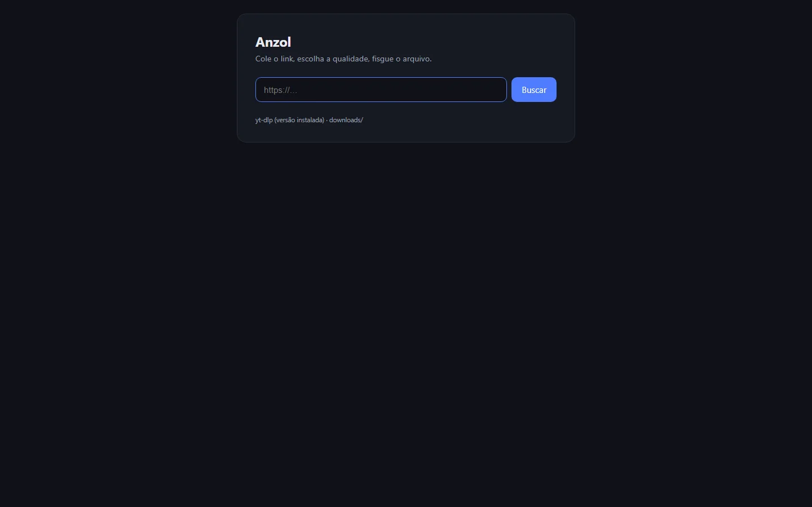
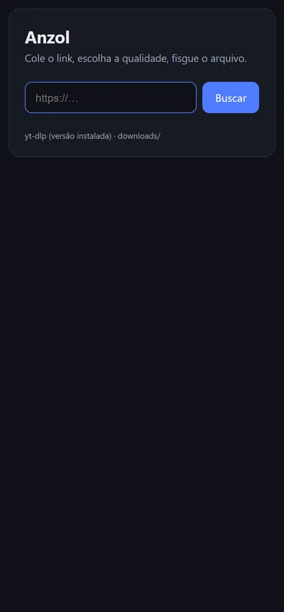

# Anzol

Baixador de vídeo e áudio com janela própria, em cima do [yt-dlp](https://github.com/yt-dlp/yt-dlp): cola o link, escolhe a qualidade, o arquivo cai numa pasta. Os mesmos sites que o yt-dlp suporta, sem a linha de comando.

**Estado:** parado (desde set/2026) · última mudança real: 04/09/2026 (`bdc518c`, "o motor sai do app.py, o arquivo certo é o que o yt-dlp diz")


## Prints





Tirados em 27/11/2026 com a interface (`static/`) servida localmente e as respostas de `/api/saude` e `/api/arquivos` simuladas, porque o Flask e o yt-dlp não estavam instalados nesta máquina. Mostra só a tela inicial, sem prévia de vídeo nem pasta de downloads preenchida.

## O que tem pronto

- **Prévia antes de baixar:** título, miniatura, duração e site de origem.
- **Qualidade à escolha:** melhor disponível, 1080p, 720p, 480p, MP3 192 kbps ou o áudio original sem reconverter.
- **Playlist inteira**, numerada em ordem, ou só o vídeo do link.
- **Progresso** com porcentagem, tamanho, velocidade e tempo restante; **cancelar** apaga os pedaços.
- **Pasta ao lado** com o que já foi baixado: link, tamanho, apagar, abrir no explorador.
- **Erros em português** no lugar do despejo técnico do yt-dlp.
- Testes em `testes/` (pytest, sem rede) e GitHub Actions rodando em Python 3.10 e 3.12.

## Onde parou e próximo passo

O último commit separou o motor (`nucleo.py`) do `app.py` e corrigiu o bug em que um `glob()` entregava o fragmento (`.f251.webm`) no lugar do vídeo pronto: agora o arquivo final vem de `requested_downloads` do próprio yt-dlp.

NÃO FOI POSSÍVEL VALIDAR qual era o próximo passo: não há lista de pendências. Candidatos, a partir dos limites conhecidos abaixo: vídeo com restrição de idade (cookies), sites com login, cancelar durante a extração.

## Como rodar

```bash
pip install -r requirements.txt

python desktop.py     # janela própria (no Windows: pythonw desktop.py, sem console)
python app.py         # ou no navegador, em http://127.0.0.1:8137
```

No Windows há também o `Anzol.cmd`: duplo clique e pronto.

O `ffmpeg` precisa estar no PATH para MP4 e MP3. Sem ele o app funciona, esconde essas opções e baixa o áudio original (M4A). Os arquivos vão para `downloads/`. A porta padrão é 8137 (variável `ANZOL_PORTA`); se estiver ocupada, ele pega outra.

Requisitos: Python 3.10+, `flask`, `yt-dlp`, `pywebview` (no Windows usa o Edge WebView2, que já vem no sistema).

Testes:

```bash
pip install pytest
pytest testes -q
```

O README anterior registrava 67 testes passando. Eles não foram rodados nesta revisão.

## Stack e pastas

Python + Flask + pywebview · interface em HTML, CSS e JS puros, sem framework e sem build.

```text
nucleo.py     o motor: fila de trabalhos, opções do yt-dlp, tradução de erro
app.py        a casca HTTP: rotas, validação, o portão do loopback
desktop.py    a janela nativa em cima do mesmo Flask
static/       a interface
testes/       pytest
```

## Decisões que valem saber antes de mexer

**O arquivo final vem do yt-dlp, não de um `glob()`.** Num merge o yt-dlp deixa `vídeo.f251.webm` e `vídeo.f616.mp4` ao lado do `.mp4` pronto. Procurar por nome podia entregar o fragmento. O app lê `requested_downloads`, que diz o que de fato ficou pronto, e varre as sobras depois.

**Cada trabalho nasce com um prefixo no nome e perde o prefixo no fim.** O prefixo deixa a faxina saber o que é deste trabalho e o que é de outro rodando ao mesmo tempo. No fim o arquivo ganha o nome limpo (e `(2)` se já existir um igual, em vez de sobrescrever).

**O servidor só atende o loopback.** Confere o endereço de origem e o cabeçalho `Host`, o que bloqueia o truque de apontar um domínio de fora para 127.0.0.1. É app de uma máquina só; o servidor de desenvolvimento do Flask não serve para ficar exposto na rede.

## Limites conhecidos

- Cancelar durante a extração (antes do primeiro byte) só tem efeito quando o download começa. São alguns segundos, não trava.
- Site com paywall, DRM ou login não foi testado. Vídeo com restrição de idade tende a falhar sem cookies.
- Playlist com item quebrado continua: o item falha, o resto baixa.
- Nada é apagado sozinho da pasta `downloads/`.

## Licença e crédito

Código sob licença MIT. O trabalho pesado é do [yt-dlp](https://github.com/yt-dlp/yt-dlp) (Unlicense); este projeto é só a interface.

Baixar conteúdo protegido por direito autoral sem permissão é problema de quem baixa, não da ferramenta. Respeite os termos de uso de cada site.
